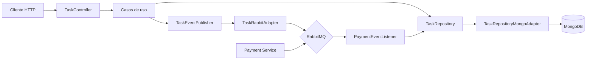
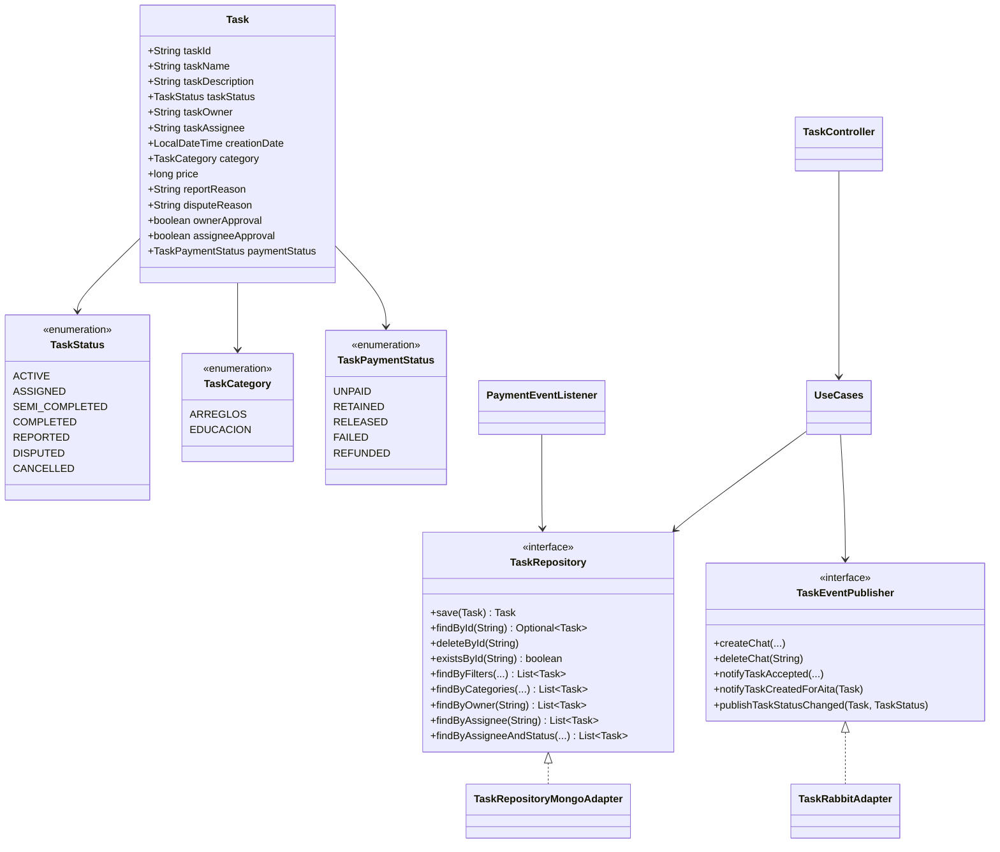

# Mstareas

Microservicio de gestión de tareas para **TaskIt**. Permite crear, editar, eliminar, buscar y asignar tareas, consultar historiales y coordinar su finalización entre el dueño y la persona asignada.

La API usa Spring Boot y MongoDB para la persistencia. RabbitMQ se utiliza para integrar el servicio con chat, pagos y AITA.

## Tecnologías

| Tecnología | Uso |
|---|---|
| Java 21 | Lenguaje y versión de compilación |
| Spring Boot 3.3.4 | Framework principal |
| Spring Web | API REST |
| Spring Data MongoDB | Persistencia de tareas |
| Spring AMQP / RabbitMQ | Publicación y consumo de eventos |
| Lombok | Reducción de código repetitivo |
| Springdoc OpenAPI | Swagger UI y especificación OpenAPI |
| Maven Wrapper | Compilación y ejecución |

## Arquitectura

El proyecto aplica una arquitectura hexagonal:





## Requisitos

- JDK 21
- Maven Wrapper incluido en el repositorio
- MongoDB
- RabbitMQ

## Configuración

La aplicación carga el archivo opcional `.env` desde la raíz del proyecto.

```properties
SPRING_DATA_MONGODB_URI=mongodb://localhost:27017/taskit
PORT=8080

RABBITMQ_HOST=localhost
RABBITMQ_PORT=5672
RABBITMQ_USERNAME=guest
RABBITMQ_PASSWORD=guest
RABBITMQ_VHOST=/
```

| Variable | Obligatoria | Valor por defecto | Uso |
|---|---:|---|---|
| `SPRING_DATA_MONGODB_URI` | Sí | — | Conexión a MongoDB |
| `PORT` | No | `8080` | Puerto HTTP |
| `RABBITMQ_HOST` | No | `jaragua.lmq.cloudamqp.com` | Host de RabbitMQ |
| `RABBITMQ_PORT` | No | `5672` | Puerto de RabbitMQ |
| `RABBITMQ_USERNAME` | No | — | Usuario de RabbitMQ |
| `RABBITMQ_PASSWORD` | No | — | Contraseña de RabbitMQ |
| `RABBITMQ_VHOST` | No | — | Virtual host de RabbitMQ |

No versionar `.env` ni incluir credenciales reales en el repositorio.

## Levantar dependencias localmente

### MongoDB

```bash
docker run -d --name taskit-mongo -p 27017:27017 mongo:7
```

### RabbitMQ

```bash
docker run -d --name taskit-rabbit \
  -p 5672:5672 \
  -p 15672:15672 \
  rabbitmq:3-management
```

Con la interfaz de gestión: `http://localhost:15672` (`guest` / `guest`).

## Ejecutar la aplicación

```bash
chmod +x mvnw
./mvnw spring-boot:run
```

También puedes generar y ejecutar el artefacto:

```bash
./mvnw clean package
java -jar target/mstareas-0.0.1-SNAPSHOT.jar
```

La API queda disponible en `http://localhost:8080`.

## API REST

Base URL: `http://localhost:8080/api/tasks`

| Método | Endpoint | Descripción |
|---|---|---|
| `GET` | `/health` | Verifica el estado del servicio |
| `POST` | `/create` | Crea una tarea |
| `PUT` | `/{taskId}` | Edita una tarea `ACTIVE` |
| `DELETE` | `/{taskId}` | Elimina una tarea `ACTIVE` |
| `PATCH` | `/{taskId}/accept` | Asigna la tarea y cambia su estado a `ASSIGNED` |
| `PATCH` | `/{taskId}/report` | Reporta una tarea |
| `PATCH` | `/{taskId}/dispute` | Disputa una tarea |
| `PATCH` | `/{taskId}/complete` | Registra una aprobación de finalización |
| `GET` | `/{taskId}/status` | Consulta las aprobaciones y el estado de finalización |
| `GET` | `/search` | Busca por categoría, precio y texto |
| `GET` | `/feed` | Obtiene tareas por categorías |
| `GET` | `/history/created/{userId}` | Lista las tareas creadas por un usuario |
| `GET` | `/history/assigned/{userId}` | Lista las tareas asignadas a un usuario |
| `GET` | `/history/completed/{userId}` | Lista las tareas completadas de un usuario |
| `GET` | `/categories` | Lista las categorías disponibles |

### Crear una tarea

```http
POST /api/tasks/create
Content-Type: application/json
```

```json
{
  "taskOwner": "user-owner-1",
  "taskName": "Reparar una bicicleta",
  "taskDescription": "Ajustar frenos y cambiar la cadena.",
  "price": 75000,
  "category": "ARREGLOS"
}
```

```bash
curl -X POST http://localhost:8080/api/tasks/create \
  -H 'Content-Type: application/json' \
  -d '{
    "taskOwner": "user-owner-1",
    "taskName": "Reparar una bicicleta",
    "taskDescription": "Ajustar frenos y cambiar la cadena.",
    "price": 75000,
    "category": "ARREGLOS"
  }'
```

### Modificar y asignar una tarea

```json
// PUT /api/tasks/{taskId}
{
  "taskName": "Reparar bicicleta y luces",
  "taskDescription": "Ajustar frenos, cadena y luces.",
  "price": 85000,
  "category": "ARREGLOS"
}
```

```json
// PATCH /api/tasks/{taskId}/accept
{
  "taskAssignee": "user-worker-1"
}
```

```json
// PATCH /api/tasks/{taskId}/report
{
  "reason": "La tarea no coincide con la descripción publicada."
}
```

```json
// PATCH /api/tasks/{taskId}/dispute
{
  "reason": "El trabajo entregado requiere revisión."
}
```

### Consultar estado y completar

```bash
curl http://localhost:8080/api/tasks/{taskId}/status
```

```json
// PATCH /api/tasks/{taskId}/complete
{
  "userId": "user-owner-1"
}
```

Debes aprobar la finalización una vez con el dueño y otra con la persona asignada. Además, el estado de pago debe ser `RETAINED` para que la tarea pase a `COMPLETED`.

### Búsqueda, feed e historiales

```bash
curl 'http://localhost:8080/api/tasks/search?category=ARREGLOS&minPrice=10000&maxPrice=100000&keyword=bici'
curl 'http://localhost:8080/api/tasks/feed?categories=ARREGLOS&categories=EDUCACION'
curl http://localhost:8080/api/tasks/history/created/user-owner-1
curl http://localhost:8080/api/tasks/history/assigned/user-worker-1
curl http://localhost:8080/api/tasks/history/completed/user-worker-1
curl http://localhost:8080/api/tasks/categories
```

Parámetros de `/search`:

| Parámetro | Tipo | Obligatorio |
|---|---|---:|
| `category` | `ARREGLOS` o `EDUCACION` | No |
| `minPrice` | número | No |
| `maxPrice` | número | No |
| `keyword` | texto | No |

Parámetros de `/feed`:

| Parámetro | Tipo | Obligatorio |
|---|---|---:|
| `categories` | lista de categorías | Sí; puede repetirse |

## Estados

| Estado | Significado |
|---|---|
| `ACTIVE` | Publicada y disponible |
| `ASSIGNED` | Tiene una persona asignada |
| `SEMI_COMPLETED` | Una de las dos partes aprobó la finalización |
| `COMPLETED` | Ambas partes aprobaron y el pago está retenido |
| `REPORTED` | Fue reportada |
| `DISPUTED` | Fue disputada |
| `CANCELLED` | Cancelada |

Estados de pago:

| Estado | Significado |
|---|---|
| `UNPAID` | Sin pago |
| `RETAINED` | Pago retenido en escrow |
| `RELEASED` | Pago liberado al trabajador |
| `FAILED` | Pago rechazado |
| `REFUNDED` | Pago reembolsado |

## Integración con RabbitMQ

Configuración principal en `RabbitConfig`:

| Exchange | Routing key / cola | Dirección | Evento |
|---|---|---|---|
| `chat.exchange` | `chat.create` | Saliente | Solicita crear el chat al asignar una tarea |
| `chat.exchange` | `chat.delete` | Saliente | Solicita eliminar el chat al completar una tarea |
| `payment.exchange` | `payment.task.accepted` | Saliente | Notifica que una tarea fue aceptada |
| `taskit.events` | `taskit.aita.events` | Saliente | Publica `TaskCreatedEvent` para AITA |
| `taskit.events` | `taskit.task.events` | Saliente | Publica cambios de estado |
| `taskit.events` | Cola `tasks.payment.events` | Entrante | Sincroniza estados de pago |

El listener consume eventos `PaymentAuthorizedEvent`, `FundsReleasedEvent`, `PaymentFailedEvent` y `PaymentRefundedEvent`.

La cola `tasks.payment.events` tiene una DLQ configurada mediante `tasks.payment.events.dlq` y el exchange `taskit.dlx`.

## Documentación interactiva

- Swagger UI: `http://localhost:8080/swagger-ui.html`
- OpenAPI: `http://localhost:8080/api-docs`

## Pruebas

```bash
./mvnw test
```

## Estructura del proyecto

```text
src/main/java/com/taskit/mstareas/
├── Application/
│   ├── Ports/Inbound/
│   ├── Ports/Outbound/
│   └── Services/
├── Domain/
│   ├── Model/
│   └── Repository/
├── Infrastucture/
│   ├── Inbound/
│   │   ├── DTO/
│   │   ├── Exception/
│   │   └── Messaging/
│   └── Outbound/
│       ├── Config/
│       ├── Messaging/
│       └── Persistence/
└── MstareasApplication.java
```
